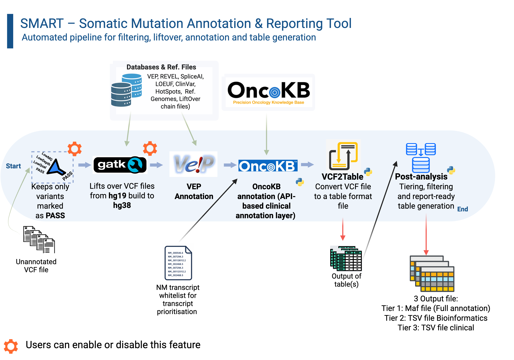
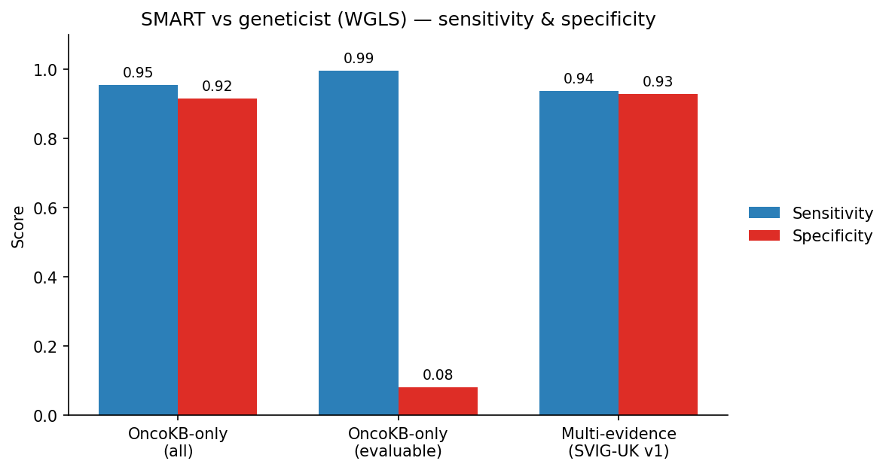

# SMART — Somatic Mutation Annotation and Reporting Tool <a href="#"></a>

<p align="center"><em>A Dockerised pipeline for somatic variant annotation, filtration, and clinical reporting.</em></p>

[](https://doi.org/10.5281/zenodo.20206503)
[](https://hub.docker.com/r/monkiky/smart)
[](https://opensource.org/licenses/MIT)
[](https://github.com/WeTGI-colab/SMART/tree/main/tests)

---

## Overview

SMART automates the end-to-end processing of somatic VCF files. Starting from raw VCFs (hg19/GRCh37 or hg38), it performs PASS filtering, optional coordinate liftover to GRCh38, comprehensive functional annotation via Ensembl VEP, clinical annotation via OncoKB, and produces final analysis-ready tables with transcript-prioritised results in three audience-targeted output tiers.

Everything runs inside a single Docker container.

---

## Workflow

<p align="center">
  
</p>

A streamlined framework for somatic variant annotation and clinical reporting.
SMART (Somatic Mutation Annotation and Reporting Tool) integrates sequential processing of somatic variants from input VCF files through quality filtering, optional liftover to GRCh38, and comprehensive functional annotation with Ensembl VEP. A key feature is transcript-level prioritisation using a curated NM whitelist to focus on clinically relevant isoforms. Variants are subsequently enriched with therapeutic, diagnostic and prognostic evidence via API-driven OncoKB annotation. Structured parsing of annotation layers enables standardisation and feature extraction, followed by tiering and filtering to produce report-ready outputs. The framework generates MAF and tabular outputs optimised for both bioinformatic analysis and clinical interpretation. While SNVs and indels are robustly supported, annotation of structural variants remains limited.

| Step | Tool | What happens |
|------|------|-------------|
| 1. PASS Filter _(optional)_ | bcftools / awk | Keep only PASS-filtered variants — disable with `--no-pass` |
| 2. LiftOver _(optional)_ | GATK 4.6 | hg19 → hg38 coordinate conversion — disable with `--no-liftover` |
| 3. VEP Annotation | Ensembl VEP 114 | Functional annotation with SpliceAI, REVEL, ClinVar, CIViC, CancerHotspots, LOEUF plugins (+ COSMIC, CADD, dbNSFP if provided) |
| 4. OncoKB Annotation _(optional)_ | oncokb2.0.py | Per-variant clinical annotation via OncoKB REST API (mutations + CNAs). Skipped in VEP-only mode (`--vep-only`, or when no OncoKB token is given), which also stops steps 5–7 |
| 5. VCF → Table | vcf2table.py | Transcript-prioritised CSV with all VEP + OncoKB fields |
| 6. MAF Annotation | MafAnnotator | OncoKB MafAnnotator for standardised MAF output |
| 7. Post-Analysis | post_analysis.py | Merge samples, expand JSON fields, apply tier filtering, produce final outputs |

---

## Transcript Selection Strategy

Both the OncoKB annotator and the table generator use the same 3-tier logic to ensure the transcript shown in the final output matches the one used to query OncoKB:

**Tier 1 — Preferred List:** Does the annotation contain a RefSeq NM ID (version-agnostic) found in the transcript whitelist provided at runtime?

**Tier 2 — MANE Select / MANE Plus Clinical:** If no Tier 1 match, use the transcript tagged as MANE Select or MANE Plus Clinical by Ensembl/NCBI.

**Tier 3 — Fallback:** If neither applies, use the first transcript reported by VEP.

This logic applies to both SNV/indel and CNA variants, ensuring consistent gene selection when multiple transcripts overlap a region.

---

> [!NOTE]
> **v1.0.0 — multi-transcript output: one row per preferred transcript**
>
> When a variant overlaps more than one transcript in the preferred whitelist, the pipeline
> now produces **one output row per matching transcript**, each with its own VEP annotation
> and independent OncoKB query.
>
> This is clinically significant for genes with multiple biologically distinct isoforms.
> The canonical example in the TSO500 panel is **CDKN2A**:
>
> - `NM_000077.5` — p16/INK4A (CDK4/6 inhibitor; MANE Select)
> - `NM_058195.4` — p14ARF (MDM2/TP53 pathway; MANE Plus Clinical)
>
> A variant affecting both isoforms now appears **twice** in the output — once for each
> isoform — with the correct protein change and OncoKB evidence level for each.
> The `NM_Transcript` column identifies which isoform each row represents.

---

## What's Inside the Container

| Tool | Version | Purpose |
|------|---------|---------|
| GATK | 4.6.0.0 | LiftOver (hg19 → hg38) |
| Ensembl VEP | 114.2 | Functional annotation |
| SpliceAI plugin | 1.3 | Splice-site impact prediction |
| REVEL plugin | 1.3 | Missense pathogenicity scoring |
| CADD plugin | v1.7 | Genome-wide deleteriousness scoring (optional — score files not shipped) |
| dbNSFP plugin | dbNSFP 5.0a | 30 additional in silico predictors and conservation scores (optional — academic licence, user-built) |
| bcftools / samtools / tabix | System | VCF manipulation |
| Python 3.10 | + pandas, cyvcf2, requests | Pipeline scripts |
| OncoKB Annotator | Latest | MafAnnotator for MAF output |

> **The container ships only _software_ — the annotation tools, VEP plugins, and pipeline scripts. It does _not_ contain the annotation databases.**
> The reference/annotation data (VEP cache, ClinVar, CIViC, COSMIC, SpliceAI, REVEL, CADD, dbNSFP, gnomAD constraints, Cancer Hotspots, liftover chain + genome) are large, separately-licensed datasets that you download once and provide at runtime via the mounted reference directory — see [Reference Files Setup](#reference-files-setup). This keeps the image small and lets each database be updated independently of the SMART code.

---

## Prerequisites

- **Docker** (v20.10+ or Docker Desktop)
- **OncoKB API token** — obtain from [oncokb.org](https://www.oncokb.org)
- **Reference files** downloaded and organised (see below)

---

## Reference Files Setup

SMART expects a reference directory with the following structure:

```
/path/to/refs/
├── liftover/
│   ├── hg19ToHg38.over.chain       # UCSC chain file
│   └── hg38.fa                      # GRCh38 reference genome + .fai + .dict
├── Plugins/                         # VEP plugin files (SpliceAI.pm, REVEL.pm, LOEUF.pm)
├── SpliceAI/                        # ONLY for --spliceai lookup (91 GB)
│   ├── spliceai_scores.raw.snv.hg38.vcf.gz      (+.tbi)
│   └── spliceai_scores.raw.indel.hg38.vcf.gz    (+.tbi)
├── SpliceAI-lookup/                 # ONLY for --spliceai compute (10 MB)
│   └── references_files/annotations/gencode.v43.annotation.txt.gz
├── REVEL/
│   └── new_tabbed_revel_grch38.tsv.gz            (+.tbi)
├── ClinVar/
│   └── clinvar.vcf.gz                            (+.tbi)
├── CIVIC/
│   └── civic_grch38.vcf.gz                       (+.tbi)
├── gnomAD_constraints/
│   └── loeuf_dataset_grch38.tsv.gz               (+.tbi)
├── CancerHotSpots/
│   └── hg38.hotspots_changv2_gao_nc.vcf.gz      (+.tbi)
├── COSMIC/                          # OPTIONAL — enables COSMIC recurrence annotation
│   └── cosmic_cmc_grch38.vcf.gz                 (+.tbi)
├── CADD/                            # OPTIONAL — genome-wide deleteriousness (~80 GB)
│   ├── whole_genome_SNVs.tsv.gz                 (+.tbi)
│   └── gnomad.genomes.r4.0.indel.tsv.gz         (+.tbi)
├── GENIE/                           # OPTIONAL — GENIE case counts (data-use agreement)
│   ├── genie_o4_counts.tsv.gz
│   └── genie_o4_counts.cohort.tsv
├── dbNSFP/                          # OPTIONAL — extra in silico predictors (academic licence)
│   └── dbNSFP5.0a_grch38.smart.gz               (+.tbi)
└── homo_sapiens/                    # VEP cache directory
    └── 114_GRCh38/
```

All reference files can be downloaded using the provided `utils/get_ref_files.sh` script (see [utils/README.md](utils/README.md)).

COSMIC is **optional** and not redistributable: if the `COSMIC/` directory is present SMART adds Cancer Mutation Census recurrence columns, otherwise it is skipped. Build the file from your own COSMIC download with `utils/cosmic_cmc_to_vcf.py` (see [utils/README.md](utils/README.md)).

CADD is also **optional**. The GRCh38 score files are very large (whole-genome SNVs ~80 GB + indels), so they are not downloaded by default. If both files are present under `CADD/`, SMART adds the `CADD_PHRED` / `CADD_RAW` columns; otherwise it is skipped. Install them by re-running the downloader with the opt-in flag: `INSTALL_CADD=1 utils/get_ref_files.sh <base_dir>`.

GENIE case counts are also **optional** and not redistributable (AACR Project GENIE data-use agreement). Build `GENIE/genie_o4_counts.tsv.gz` from your own GENIE release with `utils/build_genie_o4.py`; if present, SMART adds `GENIE_*` annotation columns (unique patients with the same nucleotide change and counted as for SVIG-UK O4, for all, haematological and solid tumours, with the commonest OncoTree codes and the cohort size) and uses the counts for O4 in Tier 4.

dbNSFP is also **optional** and not redistributable (academic releases are CC BY-NC-ND 4.0; some scores, e.g. VEST4, are free for non-commercial use only). Download dbNSFP 5.0a from [dbnsfp.org](https://www.dbnsfp.org), unzip it and build SMART's file with `python3 utils/build_dbnsfp.py --dbnsfp-dir <dbNSFP5.0a> --out <base_dir>/dbNSFP/dbNSFP5.0a_grch38.smart.gz`. If present, SMART adds one score (and the categorical prediction where dbNSFP provides one) for each predictor it does not already annotate — MutationTaster, MutationAssessor, PROVEAN, VEST4, MetaSVM, MetaLR, MetaRNN, M-CAP, MutPred, MVP, gMVP, MPC, PrimateAI, DEOGEN2, BayesDel (without allele frequency), ClinPred, LIST-S2, VARITY_R, ESM1b, AlphaMissense, PHACTboost, MutFormer, MutScore, ALoFT, DANN, fathmm-XF, Eigen, GERP++, phyloP and phastCons (100-way vertebrate) — described in `Config.yaml`. SIFT, PolyPhen, REVEL and CADD are not taken from dbNSFP because SMART already annotates them. Values for several Ensembl transcripts are separated by `&`, in the order of `Ensembl_transcriptid`.

---

### SpliceAI: download the scores, or compute them

These are two genuinely different setups and you only need one. The default is **compute**.

| | `--spliceai lookup` | `--spliceai compute` *(default)* |
|---|---|---|
| **Reference data** | **91 GB** — `spliceai_scores.raw.{snv,indel}.hg38.vcf.gz` | **10 MB** — `gencode.v43.annotation.txt.gz`, plus the GRCh38 FASTA the pipeline already requires |
| Speed | a `tabix` lookup, microseconds | model inference, ~0.6 s per variant |
| Transcript | **none recorded.** One score per gene, computed on GENCODE v24 canonical (Dec 2015) | the transcript from your `--transcripts-file`, named in `SpliceAI_pred_SYMBOL` as `GENE--REFSEQ` |
| Window | **±50 bp, fixed.** A splice effect further out is reported as `0.00` | 500 bp |
| Multi-nucleotide variants | scored, if the table holds them | **not scored** — the released model does not support them; the run warns per sample |
| Reproducibility | a static file | the pinned model and annotation versions |

Both honour `--spliceai-mask 0|1` (default `1`, masked), which is what SpliceAI's developers
recommend for variant interpretation.

**Which to choose.** Compute, unless you cannot. The precomputed tables carry no transcript and
stop at ±50 bp, and neither limit can be configured away — they are properties of the files. For
16 of a 519-transcript panel the gene-level score describes a different transcript from the one
reported, MET, HRAS, AKT1, FGFR1 and CDKN2A among them, and a gene whose transcript grew between
GENCODE releases can have no coverage at all over part of it: TET2's reported transcript has
37 kb — 28% of its length — with no precomputed record.

Lookup remains the right choice if you cannot spend CPU per variant, if you need MNVs scored, or
if you want scores reproducible from a file rather than from a model.

`compute` fails with a clear message if `gencode.v43.annotation.txt.gz` is absent, naming
`--spliceai lookup` as the alternative. It does not fall back silently. Full detail, including the
validation against the Broad's own service, is in
[`docs/spliceai_local.md`](docs/spliceai_local.md).

---

## Quick Start

### 1. Clone and build

```bash
git clone https://github.com/Manuel-DominguezCBG/SMART.git
cd SMART
docker build -t smart:latest .
```

### 2. Add your data

```bash
mkdir -p data/OriginalVcf
cp /path/to/your/*.vcf.gz data/OriginalVcf/
cp /path/to/transcripts_list.txt data/
```

### 3. Run

```bash
export ONCOKB_TOKEN=your_token_here

docker run --rm \
  -v /path/to/your/input:/data \
  -v /path/to/your/output:/results \
  -v /path/to/your/refs:/refs:ro \
  monkiky/smart:latest \
  "$ONCOKB_TOKEN" \
  --transcripts-file /data/transcripts_list.txt \
  --config /data/Config.yaml \
  --ref-dir /refs \
  --output-dir /results \
  --input-dir /data \
  --no-liftover \
  --keep-tmp \
  --keep-tables
```

For example, using the verification1 test set:

```bash
docker run --rm \
  -v /path/to/SMART/tests/verification1:/data \
  -v /path/to/SMART/tests/verification1/output:/results \
  -v /path/to/refs:/refs:ro \
  monkiky/smart:latest \
  "$ONCOKB_TOKEN" \
  --transcripts-file /data/verification1_transcripts.txt \
  --config /data/Config.yaml \
  --ref-dir /refs \
  --output-dir /results \
  --input-dir /data \
  --no-liftover \
  --keep-tmp \
  --keep-tables
```

Or with docker compose (edit `docker-compose.yml` volume paths first):

```bash
docker compose run --rm smart
```


---

## Command-Line Options

```
Usage:
  smart <ONCOKB_TOKEN> --transcripts-file FILE --ref-dir DIR [OPTIONS]

Required:
  <ONCOKB_TOKEN>                   OncoKB API token
  --transcripts-file FILE          Transcript whitelist for prioritisation
  --ref-dir DIR                    Reference resources directory

Options:
  --pass / --no-pass               Enable/disable PASS filtering (default: ON)
  --liftover / --no-liftover       Enable/disable hg19→hg38 liftover (default: ON)
  --clean-tmp / --keep-tmp         Delete/keep intermediate files (default: clean)
  --clean-tables / --keep-tables   Delete/keep per-sample tables after
                                   post_analysis merging (default: clean)
  --jobs N                         Number of samples to process in parallel on this
                                   machine (default: 1 = sequential). Requires
                                   internet access for OncoKB — not suitable for
                                   HPC compute nodes without internet.
  --vep-only                       Stop after VEP annotation. Skips OncoKB,
                                   vcf2table, MafAnnotator, and post-analysis.
                                   VEP-annotated VCFs are written to AnnotatedVcf/.
                                   --transcripts-file and --config are not required
                                   in this mode.
  --tumour-type TYPE               Tumour type for the Tier 4 classification: OncoTree
                                   code (e.g. AML, MDS, LUAD) or myeloid | lymphoid |
                                   haem | solid | unknown (default: unknown). A
                                   per-variant TUMOUR_TYPE column takes precedence.
  --o4-on-target LEVEL             GENIE entries counted for O4: code | tissue |
                                   lineage | all (default: lineage)
  --no-classification              Do not write the Tier 4 classification
  --help                           Show help
```

---

## Output

All results are written to the mounted `/data` directory:

| File | Description |
|------|-------------|
| `variant_counts.txt` | Per-sample variant counts at each pipeline stage |
| `Output_Results/` | Final merged results from post-analysis |

### Output tiers

The pipeline produces three annotation files and one classification file:

| File | Audience | Contents |
|------|----------|----------|
| `Final_result_tier1.maf` | Downstream tools | All non-dropped fields in standard MAF format (~1028 columns; exact count varies with the number of OncoKB treatment, diagnostic, and prognostic entries returned for the variants in the run) |
| `Final_result_tier2.tsv` | Bioinformaticians | Selected fields with two-row header (field names + metadata) |
| `Final_result_tier3.tsv` | Clinical scientists | Clinically relevant fields with two-row header |
| `Final_result_tier4.tsv` | Clinical scientists | SVIG-UK oncogenicity classification — kept separate from the annotation. Two-row header (field names; description, source and version of the classification system). One row per Tier 1 row: variant identifiers, tumour type and gene role used, final class and score, **one column per SVIG-UK code** (O1–O11, B1–B7) with the strength and points applied, the evidence behind every code, codes removed by combination rules, and the population, in silico and OncoKB values used. Every row carries `SVIG_UK_REVIEW_STATUS` (automated suggestion, to be confirmed by a clinical scientist) and `SVIG_UK_REVIEW_FLAGS`. A structured copy is written to `Final_result_tier4.json`. See [SVIG-UK oncogenicity classifier](#svig-uk-oncogenicity-classifier) |

When `--keep-tmp` is used, intermediate files are retained:

| Directory | Contents |
|-----------|----------|
| `FilteredVcf/` | PASS-only VCFs |
| `LiftOverVcf/` | hg38-lifted VCFs |
| `LiftOverVcf/Rejected/` | Variants that failed liftover |
| `AnnotatedVcf/` | VEP-annotated VCFs |
| `OncoKB_VCF/` | OncoKB-annotated VCFs |
| `Table/` | Per-sample CSV tables |
| `FINAL_Table/` | Per-sample MAF files |

---

## Example Output

The example below is taken from the [verification1](tests/verification1/) test run — 22 curated variants from a single sample. The variant shown is **IDH1 R132H**, a well-characterised oncogenic hotspot with OncoKB Level 1 actionability in glioma and cholangiocarcinoma.

> **[Browse the full verification1 output interactively →](https://manuel-dominguezcbg.github.io/SMART/example-output.html)**
> All three tier files (Tier 3: 77 cols · Tier 2: 670 cols · Tier 1: 1,028 cols) rendered as searchable,
> sortable tables with colour-coded OncoKB levels and per-tier column visibility controls.

---

### Tier 3 — Clinical report &nbsp;(`Final_result_tier3.tsv` · 77 columns)

Optimised for clinical scientists. One row per variant, curated fields only, two-row header (field names + source metadata).

| Field | Value |
|-------|-------|
| Sample | `TUMOR` |
| Gene | `IDH1` |
| Variant (short) | `p.R132H` |
| Variant (full) | `ENSP00000260985.2:p.Arg132His` |
| Transcript | `NM_005896` |
| Genomic location (GRCh38) | `chr2:208,248,388` |
| Change | `C > T` |
| Consequence | `missense_variant` |
| Variant class | `SNV` |
| VAF | `0.326` &nbsp;(30 alt / 92 total reads) |
| ClinVar significance | `Pathogenic / Likely pathogenic` |
| ClinVar oncogenicity | `Oncogenic · Tier I – Strong` |
| CancerHotspots | hotspot confirmed |
| OncoKB oncogenicity | `Oncogenic` |
| Mutation effect | `Switch-of-function` |
| OncoKB hotspot | `True` |
| **Highest level** | **`LEVEL_1`** |
| Level 1 treatments | `Ivosidenib · Olutasidenib · Vorasidenib` |
| Level 2 treatments | `Ivosidenib` |
| Diagnostic level | `LEVEL_Dx2` |
| REVEL score | `0.852` |
| SpliceAI max delta | `0.04` |
| LOEUF | `0.829` |
| gnomAD max AF | `3.83 × 10⁻⁵` (gnomADe_ASJ) |

---

### Tier 2 — Bioinformatics report &nbsp;(`Final_result_tier2.tsv` · 670 columns)

Extends Tier 3 with:
- Full gnomAD population stratification (exomes + genomes, 7 ancestry groups)
- All four SpliceAI delta scores (AG, AL, DG, DL) per variant
- Complete structured ClinVar and CIViC fields (variant type, consequence, disease, therapies, evidence level, AMP category)
- Expanded OncoKB JSON arrays — every treatment, diagnostic, and prognostic implication is unpacked into indexed columns (`ONCOKB_TX_0_level`, `ONCOKB_TX_0_drugs`, `ONCOKB_TX_0_tumorType`, `ONCOKB_DIAG_0_level`, …)

For **IDH1 R132H** this adds 15 structured treatment entries across three tumour types, two diagnostic entries, and two prognostic entries.

Intended for bioinformatics QC, cohort-level analysis, and integration with downstream pipelines.

---

### Tier 1 — Full MAF &nbsp;(`Final_result_tier1.maf` · 1,028 columns)

Standard MAF format carrying all non-dropped fields. Includes every `ONCOKB_TX_0` … `ONCOKB_TX_33` treatment expansion column, every diagnostic and prognostic implication entry, plus all raw VCF FORMAT fields.

> **Note on the column count.** The OncoKB treatment, diagnostic, and prognostic implications are expanded into indexed columns (`ONCOKB_TX_0` … `ONCOKB_TX_33`, `ONCOKB_DIAG_*`, `ONCOKB_PROG_*`). To avoid emitting a large block of permanently empty columns, this expansion is **pruned dynamically**: only the index positions populated for at least one variant in the run are kept. The canonical full count is **1,028 columns**. Consequently the exact number varies with the breadth of OncoKB evidence returned for that specific set of variants — and if *none* of the variants in a given analysis populate any of the dynamic OncoKB expansion columns, the count can fall to roughly **800**. A lower count is therefore expected behaviour for small or low-evidence variant sets, not a pipeline error. The same dynamic pruning applies to Tier 2.

Designed for direct input to downstream tools such as cBioPortal, oncoPrint generators, and custom R/Python analysis scripts.

---

## Output Annotations (~1028 columns) — [Full field reference →](https://manuel-dominguezcbg.github.io/SMART/fields/)

The final table includes annotations from multiple sources. Key field groups:

**Core VCF:** CHROM, POS, ID, REF, ALT, QUAL, FILTER, FORMAT

**VEP Functional:** Consequence, IMPACT, SYMBOL, HGVSc, HGVSp, BIOTYPE, EXON, INTRON, SIFT, PolyPhen, VARIANT_CLASS, CANONICAL, MANE_SELECT, MANE_PLUS_CLINICAL

**Population Frequency:** gnomADe/gnomADg allele frequencies across populations, MAX_AF

**Splice & Pathogenicity:** SpliceAI delta scores (AG/AL/DG/DL), REVEL missense score, LOEUF constraint

**Clinical Databases:** ClinVar (significance, review status, conditions), CIViC (variant type, consequence), CancerHotspots (hotspot and 3D hotspot flags)

**OncoKB Core:** Oncogenic classification, mutation effect, gene/variant exist flags, hotspot, VUS flag, gene and variant summaries

**OncoKB Therapeutic Levels:** LEVEL_1 through LEVEL_R2, HIGHEST_SENSITIVE_LEVEL, HIGHEST_RESISTANCE_LEVEL, HIGHEST_LEVEL, ONCOKB_highestFdaLevel

**OncoKB Diagnostic/Prognostic:** ONCOKB_DIAG_LVL, ONCOKB_PROG_LVL, ONCOKB_diagnosticSummary, ONCOKB_prognosticSummary

**OncoKB Expanded JSON:** Treatment, diagnostic, and prognostic implication entries are expanded from JSON arrays into individual columns (e.g. `ONCOKB_TX_0_level`, `ONCOKB_TX_0_drugs`, `ONCOKB_DIAG_0_level`, `ONCOKB_PROG_0_tumorType`, etc.), producing hundreds of additional columns for full structured access.

---

## Variant Classification

SMART classifies variants to route them to the correct OncoKB API endpoint:

| Variant Type | Examples | OncoKB Endpoint |
|-------------|----------|-----------------|
| Mutations | SNVs, indels, MantaINS, MantaBND | `/annotate/mutations/byProteinChange` |
| Copy Number | MantaDUP, MantaDEL, GAIN, LOSS | `/annotate/copyNumberAlterations` |

Structural insertions (MantaINS) are intentionally routed to the mutation endpoint because they alter gene sequence and produce specific protein changes (e.g. EGFR Exon 20 insertions) that require distinct targeted therapies, unlike simple gene dosage changes.

### CNA annotation

For copy-number variants, SMART applies the same 3-tier transcript selection logic to determine the correct gene symbol before querying OncoKB. This prevents misannotation in regions where multiple genes overlap (e.g. selecting CDKN2A over the adjacent CDKN2B for a 9p21 deletion).

Because MafAnnotator does not correctly annotate CNA rows, the pipeline's post-analysis step overrides MafAnnotator's output for CNA variants with values derived directly from the OncoKB API: `VARIANT_IN_ONCOKB`, `ONCOGENIC`, `MUTATION_EFFECT`, all treatment levels, and `HIGHEST_SENSITIVE/RESISTANCE_LEVEL`.

---

## Validation against expert classification

> **These results were obtained with the earlier heuristic multi-evidence scorer (v1)**, whose point values were not taken from the SVIG-UK guideline. It has been replaced by the guideline-based [SVIG-UK oncogenicity classifier](#svig-uk-oncogenicity-classifier); re-validation against the same expert classification is pending and these figures will be updated.

SMART's calls were benchmarked against an independent expert classification: the WGLS oncology team manually classified **1,054 onco-related variants across 58 genes** following SVIG-UK. Two classifiers were compared: the current OncoKB-only verdict and an experimental multi-evidence SVIG-UK scorer that also folds in ClinVar, REVEL/SpliceAI, gnomAD frequency, hotspots and gene constraint.

Binary task, positive = geneticist (Likely) Oncogenic:

| Classifier | N | Sens | Spec | Weighted κ |
|---|---|---|---|---|
| OncoKB-only, all variants | 1,054 | 0.953 | 0.915 | 0.63 |
| OncoKB-only, evaluable (OncoKB had data) | 539 | 0.994 | **0.080** | — |
| Multi-evidence (SVIG-UK v1) | 1,054 | 0.937 | 0.928 | **0.74** |

> **Weighted κ** is Cohen's kappa with linear weights over the ordinal Benign < VUS < Oncogenic scale. It measures agreement with the geneticist *above chance*, penalising each disagreement by how far apart the two calls are — an Oncogenic↔Benign mismatch (2 steps) counts double an Oncogenic↔VUS one (1 step). Unlike raw accuracy it discounts the trivial agreement created by OncoKB's no-data→VUS abstentions, which is why it is used as the headline metric here. By the Landis & Koch convention 0.61–0.80 is "substantial" agreement; the multi-evidence gain (0.63 → 0.74) comes mostly from fixing benign-side 2-step errors.

### Confusion counts (TP / TN / FP / FN)

SMART is treated as **positive** when it calls a variant (Likely) Oncogenic, with the geneticist's classification as ground truth. Every variant then falls into one of four cases:

- **TP — true positive:** SMART called it oncogenic *and* the geneticist agrees → a correctly flagged actionable variant.
- **FP — false positive:** SMART called it oncogenic but the geneticist did not → an over-call (often defensible — see the tumour-type caveat below).
- **TN — true negative:** SMART did **not** call it oncogenic *and* neither did the geneticist → a correctly *not*-flagged variant.
- **FN — false negative:** SMART did not call it oncogenic but the geneticist did → a **missed** actionable variant, the most clinically important error.

**OncoKB-only, all variants (N = 1,054)**

| | Expert **+** | Expert **−** | |
|---|---|---|---|
| **Test +** | TP = 486 | FP = 46 | PPV = 486/(486+46) = **0.914** |
| **Test −** | FN = 24 | TN = 498 | NPV = 498/(24+498) = **0.954** |
| | Sens = 486/(486+24) = **0.953** | Spec = 498/(498+46) = **0.915** | |

**OncoKB-only, evaluable — OncoKB had data (N = 539)**

| | Expert **+** | Expert **−** | |
|---|---|---|---|
| **Test +** | TP = 486 | FP = 46 | PPV = 486/(486+46) = **0.914** |
| **Test −** | FN = 3 | TN = 4 | NPV = 4/(3+4) = **0.571** |
| | Sens = 486/(486+3) = **0.994** | Spec = 4/(4+46) = **0.080** | |

**Multi-evidence, all variants (N = 1,054)**

| | Expert **+** | Expert **−** | |
|---|---|---|---|
| **Test +** | TP = 478 | FP = 39 | PPV = 478/(478+39) = **0.925** |
| **Test −** | FN = 32 | TN = 505 | NPV = 505/(32+505) = **0.940** |
| | Sens = 478/(478+32) = **0.937** | Spec = 505/(505+39) = **0.928** | |

**The TN caveat — why the "evaluable" row matters.** The TN column of the first row (498) looks like a strong negative class, but it is misleading. **515 of the 1,054 variants have no OncoKB data at all** and default to VUS, i.e. "not oncogenic" — so almost all of those 498 TN are *abstentions*, not genuine "this is benign" judgements. When the count is restricted to the **539 variants OncoKB actually has data for**, the TN collapses to **4**: OncoKB almost never makes a confident non-oncogenic call, so its negative class is essentially untested. A high TN (and therefore high specificity) in the all-variants row is largely an artefact of OncoKB's missing data, not evidence that it discriminates benign variants. The multi-evidence scorer instead reaches **505 TN** by *actively* classifying those data-less variants, which is exactly where its specificity gain (0.92 → 0.93) comes from.

Key findings:

- **Coverage drives the headline numbers.** 48.9% (515/1,054) of variants have no OncoKB data and default to VUS. Those abstentions count as "true negatives" in the all-variants row, inflating specificity. On the 539 variants OncoKB *actually* has data for, specificity collapses to **0.08** — OncoKB almost never calls a variant non-oncogenic, so its negative class is essentially untested. Always report coverage alongside accuracy.
- **Multi-evidence adds value on the benign side.** Per-class agreement with the geneticist for benign variants rises from 0% (OncoKB-only) to 98% (multi-evidence), lifting specificity (0.92 → 0.93) and weighted kappa (0.63 → 0.74).
- **Missed oncogenic calls are recovered by COSMIC (O4).** The false negatives are dominated by OncoKB-blind variants that are nonetheless recurrent in tumours. Enabling the optional COSMIC somatic-recurrence track (evidence code O4) is the single change that recovers them — see *Impact of COSMIC* below.



**Impact of COSMIC (O4).** With the optional COSMIC Cancer Mutation Census track enabled, the multi-evidence scorer gains a somatic-recurrence signal (code O4). On this set it recovers **5 expert-oncogenic variants** the scorer otherwise missed (TET2 ×2, U2AF1, BTK, PHF6 — all recurrent in COSMIC, sample counts 14–57) at a cost of **2 new false positives**, lifting **sensitivity 0.937 → 0.951** and **weighted kappa 0.74 → 0.754** with specificity essentially unchanged (0.928 → 0.925). This is precisely the evidence OncoKB lacks: of the variants OncoKB has no data for, COSMIC covers ~40% — and ~70% of the *oncogenic* ones. (COSMIC is licence-gated and optional; see [utils/cosmic_cmc_to_vcf.py](utils/cosmic_cmc_to_vcf.py).)

The v1 multi-evidence scorer used here is kept for reference in `data/jack_list_validation/validation_report/` (`score_multievidence_inplace.py`, `smart_multievidence.py`). The curated variant set itself was constructed by the reference laboratory and is **not redistributed** with this repository; it is available on request.

> The geneticist labels are tumour-type specific while SMART/OncoKB is tumour-agnostic, so some "false positives" are defensible rather than errors. This caveat affects the false-positive count more than the false-negative count.

### Class harmonisation

OncoKB, the geneticist (WGLS, 5-class SVIG-UK) and the multi-evidence scorer use
different label spaces, so all three were mapped onto a common Oncogenic / VUS / Benign
scale before comparison:

| Source | → Oncogenic (ONC) | → VUS | → Benign (BEN) |
|--------|-------------------|-------|----------------|
| OncoKB-only | `Oncogenic`, `Likely Oncogenic` | `Unknown` / no data | `Likely Neutral`, `Neutral` |
| Geneticist (`WGLS`) | `Oncogenic`, `Likely Oncogenic` | `VUS` | `Likely Benign`, `Benign` |
| Multi-evidence | `Oncogenic`, `Likely Oncogenic` | `VUS` | `Likely Benign`, `Benign` |

For the binary metrics, **positive = (Likely) Oncogenic** on both sides.

### SVIG-UK oncogenicity classifier

`scripts/svig_uk_classifier.py` classifies each variant in a SMART MAF following the
**ACGS / SVIG-UK 2025** guidelines, version 1.1 (26/05/2026) ([v1.0 main guideline](docs/guidelines/svig-uk_guidelines_v10.pdf),
[v1.0 supplementary material](docs/guidelines/svig-uk_supplementary_material.pdf); combination numbers and the
canonical variants list follow the v1.1 revision log). The pipeline runs it after post-analysis and writes
`Final_result_tier4.tsv`. It replaces the
earlier heuristic multi-evidence scorer, whose point values were not taken from the guideline.

**Design principles**

1. Every rule follows the guideline text; each is cited in the code (`[G §x]` main guideline,
   `[S Tn]` / `[S Fn]` supplementary tables and figures).
2. Only the official strengths are used — **+8 / +4 / +2 / +1** and **−8 / −4 / −2 / −1** —
   plus the stand-alone outcomes of O1, B1 and B2.
3. Where the guideline needs a judgement that annotation data cannot supply, the rule is
   either omitted or replaced by a labelled **SMART proxy**: an automatable approximation that is
   never stronger than the guideline would allow.
4. Each code is applied once, the code-combination restrictions of Supplementary Figures 1 and 2
   are enforced, and the **minimum-two-codes rule** is applied: a (likely) oncogenic or (likely)
   benign class needs at least two codes in the same direction, otherwise the variant is a VUS.
5. Weights were fixed from the guideline alone, before evaluation against expert-classified variants.

**Evidence codes**

| Code | Guideline rule (strength) | SMART implementation | Data | Status |
|------|---------------------------|----------------------|------|--------|
| O1 | SVIG-UK canonical variants list — stand-alone, with the list's Oncogenic / Likely Oncogenic assessment | Protein match (frameshift tail ignored); genomic match for TERT promoter; FLT3 exon-14 in-frame duplication for ITD | [`reference_lists/svig_uk_canonical_variants.tsv`](reference_lists/svig_uk_canonical_variants.tsv) (Supplementary Table 3) | As written |
| O2 | Null variant in a tumour suppressor, PVS1 decision tree (+8/+4/+2/+1) | Stop/frameshift: NMD predicted unless the stop falls in the final exon or the last 50 bp of the penultimate exon (+8); NMD escape → +4 if >10% of the protein is altered, else +2; stop in the first 100 bp of exon 1 +2. Canonical ±1/2 splice: the nearest exon is assumed skipped — in-frame → +4/+2 by protein fraction, out-of-frame → reading frame translated from the genome, +8 if the new stop triggers NMD; first/final intron or a SpliceAI-predicted cryptic site within ±20 bp +2; skipping the initiation-codon exon +1; +2T>C only if SpliceAI ≥ 0.8, +2C>T never; variants that are not ±1/2 on the 3'-shifted HGVS description get no splice O2. Start-loss +1 | VEP consequence, HGVSc/HGVSp, EXON/INTRON; RefSeq exon structure (UCSC `ncbiRefSeq`); GRCh38 FASTA; SpliceAI; gene role | Proxy — "region critical to protein function" is not judged, only the >10% branch; without transcript models the lowest reachable strength is used |
| O3 | Absent from gnomAD v4.1 (+2); ≤0.001% in a sub-population of ≥100,000 alleles (+1), not if >1 allele in a smaller sub-population | As written; allele counts estimated from allele frequency and gnomAD v4 sample sizes. Not applied if it would lift otherwise likely-benign evidence into VUS. CHIP correction for DNMT3A, ASXL1, TET2 and TP53: when neither O3 nor B1 applies and total AF >0.001%, the frequency is recalculated from gnomAD carriers with VAF 0.30–0.65 (none → +2, ≤0.001% → +1). Hereditary cancer genes with ClinGen VCEP rules (TP53, RUNX1, PTEN, CDH1, ATM, PALB2, BRCA1/2, APC, MLH1, MSH2, MSH6, PMS2, VHL, DICER1) use the panel's PM2 cut-off | gnomAD v4.1 exomes + genomes (VEP); gnomAD v4.1 allele-balance histograms for the CHIP genes | As written; CHIP recalculation uses the combined exome + genome total because allele balance is not given per population |
| O4 | Enriched in a somatic database (GENIE thresholds by variant class, +4/+2/+1); needs O3; not with B1/B2 | **GENIE (preferred)**: unique patients, thresholds as written — missense (same amino-acid change, any nucleotide change) and canonical splice (exact nucleotide change) >10 / 5–10; frameshift/nonsense at the same residue or downstream and in-frame (exact insertion; deletions equal to or within the deleted region) >50 / 20–50 / 10–19. GENIE entries are lifted to GRCh38, left-aligned and matched by genomic change, with residues computed on the transcript SMART annotated. The tumour type (`--tumour-type` or a per-variant `TUMOUR_TYPE` column) is an OncoTree code (e.g. `AML`, `MDS`, `DLBCLNOS`) or a broad group (`myeloid`, `lymphoid`, `haem`, `solid`); `--o4-on-target` chooses which entries count: `code` (the code and its subtypes), `tissue` (e.g. all myeloid), `lineage` (haematopoietic or solid; default) or `all` (off-target included). A finer level than the tumour type given falls back to the finest available; an unknown tumour type counts all entries; a patient counts once if any of their samples is on-target; lineage-dependent genes (EZH2) never count the other lineage. **COSMIC (fallback when no GENIE table)**: CMC sample counts, all tissues, every GENIE threshold ×5 | GENIE table built by `utils/build_genie_o4.py` from your licensed GENIE release (optional); COSMIC CMC (optional, user-licensed) | As written for GENIE; COSMIC is a proxy (no on-target counting) |
| O5 | Different (likely) oncogenic change at the same residue, compared by REVEL (+2/+1) | Missense route: a (likely) oncogenic reference with a different amino acid at the same residue; +2 if the variant's REVEL is within 0.02 of or above the reference's, or both >0.773; +1 if the variant's REVEL is >0.7 and <0.773 and lower. Reference REVEL = highest score among nucleotide changes giving that amino acid change. References on another transcript are mapped through the genome; references without a transcript must match residue and reference amino acid. Not with O7 (stronger kept), removes O8 and O10 | SVIG-UK canonical list; optional CGI catalogue table (`utils/build_o5_references.py`); REVEL table (tabix); RefSeq exon structure | Proxy — catalogue references are not accredited-laboratory classifications and a shared mechanism of action is assumed; splice and initiation-codon routes not automated |
| O6 | REVEL ≥ 0.7 or SpliceAI Δ ≥ 0.2 (+1 max); in gain-of-function genes only within functional regions | As written; "functional region" = curated protein domain or Cancer Hotspots residue | REVEL, SpliceAI, VEP DOMAINS | As written |
| O7 | Cancer Hotspots: ≥50 at residue and ≥10 same change (+4); <50 and ≥10 (+2); 2–9 same change (+1) | Cancer Hotspots route as written; the functional-domain routes (which need judgement on local benign variation) are not used | Cancer Hotspots counts | As written (hotspot route) |
| O8 | Missense constraint, gnomAD missense Z ≥ 3.09 (+1) | As written, on the transcript SMART selected (MANE fallback) | gnomAD constraint | As written |
| O9 | In-frame change in a functional domain (>1 residue +2, single residue +1); truncation in the final exon of an oncogene (+2) | "Functional domain" = Pfam, SMART, PROSITE, CDD, PRINTS, HAMAP, NCBIFAM or PIRSF entry from VEP | VEP DOMAINS | Proxy |
| O10 | Well-established functional studies (+8/+4/+2/+1) | OncoKB variant-level mutation effect (Gain/Switch-of-function in an oncogene, Loss-of-function in a TSG) at **supporting** strength only | OncoKB | Proxy |
| O11 | Tumour phenotype | — | IHC, MSI, TMB, LOH | Not automated |
| B1 | gnomAD >1% stand-alone benign; >0.1% (−4); hereditary cancer genes: ClinGen VCEP BA1 (stand-alone) and BS1 (−4) | Overall or highest of AFR/EAS/NFE/AMR/SAS, exomes or genomes | gnomAD v4.1 | As written |
| B2 | Variant does not fit the gene's mode of action — stand-alone VUS | Null variant in a gene with an oncogene role and no tumour-suppressor role (final-exon truncations go to O9 instead). Activating variants in TSGs are not detected | COSMIC Cancer Gene Census (OncoKB fallback) | Proxy |
| B3 | REVEL ≤ 0.4 (not for activating variants) or all SpliceAI Δ ≤ 0.1 (−1) | REVEL route only in genes with a tumour-suppressor role | REVEL, SpliceAI | As written |
| B4 | Synonymous / intronic (≥+7 or ≤−21) / UTR with no predicted splicing impact (−1 in silico; −4 needs an RNA assay) | In silico route (−1); synonymous variants in the splice region excluded | VEP consequence, HGVSc, SpliceAI | As written |
| B5 | In-frame indel in a repetitive region of unknown function (−1) | Low-complexity sequence outside any functional domain | VEP DOMAINS | Proxy |
| B6 | Functional studies showing no effect (−4/−2/−1) | OncoKB variant-level mutation effect "Neutral" at supporting strength only | OncoKB | Proxy |
| B7 | Tumour phenotype | — | — | Not automated |

**Mode of action and tumour type.** Gene roles come from the COSMIC Cancer Gene Census, as the
guideline recommends, with OncoKB gene roles as fallback. Where the guideline states a
tumour-type-specific role it is applied explicitly (EZH2: tumour suppressor in myeloid,
activating in lymphoid). The tumour type is read from a `TUMOUR_TYPE` column or `--tumour-type`.

**Combination rules enforced** (Supplementary Figures 1–2 and code guidance): O6, O7 and O9 are
removed when O2 applies; O10 is removed with null variants; O6 is removed with O9; O8 is removed
with O7; O6 + O7 are capped at 4 points; O4 needs O3 and is removed with B1; O7 is removed when B1
applies; B6 is removed when SpliceAI predicts a splicing impact.

**Output columns** (`--out`: appended to a copy of the Tier 1 MAF; the Tier 4 file, `--tier4`, also has one column per code)

| Column | Content |
|--------|---------|
| `SVIG_UK_CLASS` | Oncogenic / Likely Oncogenic / VUS / Likely Benign / Benign |
| `SVIG_UK_SCORE` | Sum of points (empty for stand-alone O1, B1, B2) |
| `SVIG_UK_CODES` | Every code applied, e.g. `O2_VSTR(+8) [premature stop predicted to trigger NMD]; O3_MOD(+2) [absent from gnomAD v4.1 exomes and genomes]` |
| `SVIG_UK_NOTES` | Codes removed by combination rules, minimum-two-codes downgrades and resources not provided |

**Usage**

```bash
# once: build the COSMIC-derived lookups from your licensed COSMIC downloads
python3 utils/build_svig_uk_resources.py \
    --cgc-tar /refs/COSMIC/Cosmic_CancerGeneCensus_Tsv_v104_GRCh38.tar \
    --cmc-tar /refs/COSMIC/CancerMutationCensus_AllData_Tsv_v104_GRCh37.tar \
    --out-dir /refs/SVIG_UK

# classify a SMART MAF
python3 scripts/svig_uk_classifier.py \
    --maf output/Final_result_tier1.maf \
    --tier4 output/Final_result_tier4.tsv \
    --refs /refs --tumour-type AML
```

Resources are resolved against `--refs` (`SVIG_UK/cgc_gene_roles.tsv`,
`SVIG_UK/cosmic_o4_counts.tsv.gz`, `oncokb_gene_roles.tsv`,
`CancerHotSpots/cancerhotspots_counts.json`, `gnomAD_constraints/loeuf_dataset_grch38.tsv.gz`,
`OncoTree/oncotree_2025_10_03.json` (the OncoTree release used to resolve codes and subtypes),
`reference_lists/svig_uk_vcep_population_thresholds.tsv` (shipped; ClinGen VCEP population cut-offs),
`GENIE/genie_o4_counts.tsv.gz` — built with
`python3 utils/build_genie_o4.py --genie-dir <GENIE release> --oncotree /refs/OncoTree/oncotree_2025_10_03.json --chain /refs/liftover/hg19ToHg38.over.chain --fasta /refs/liftover/hg38.fa --out /refs/GENIE/genie_o4_counts.tsv.gz`;
GENIE's data-use agreement forbids redistribution, so keep this file with your licensed data —,
`REVEL/new_tabbed_revel_grch38.tsv.gz` (tabix-indexed, needs `tabix` on the PATH),
`SVIG_UK/o5_reference_variants.tsv` — built with
`python3 utils/build_o5_references.py --cgi-dictionary <OncoVI>/resources/cgi_dictionary.txt --out /refs/SVIG_UK/o5_reference_variants.tsv` —,
`SVIG_UK/gnomad_v41_chip_allele_balance.tsv.gz` — built with
`python3 utils/build_gnomad_chip_ab.py --transcript-models /refs/TranscriptModels/ncbiRefSeq.hg38.txt.gz --out /refs/SVIG_UK/gnomad_v41_chip_allele_balance.tsv.gz`,
which queries the public gnomAD v4.1 VCFs remotely with tabix —,
`TranscriptModels/ncbiRefSeq.hg38.txt.gz` — the UCSC hg38 `ncbiRefSeq` table from
`hgdownload.soe.ucsc.edu/goldenPath/hg38/database/ncbiRefSeq.txt.gz` — and the
`liftover/hg38.fa` FASTA already used by VEP). The transcript used for O2 is the one SMART
annotated; its RefSeq version must be present in the table and its exon count must agree with
VEP, otherwise O2 falls back to the lowest reachable strength.
Each is optional; when one is missing the dependent codes are listed as not evaluated in
`SVIG_UK_NOTES` rather than silently skipped.

**Known limitations**

- The O5 splice and initiation-codon routes, O11 and B7 are not automated, and the RNA-assay forms of O2 and B4 are not used.
- O2 does not judge whether a lost region is critical to protein function, so truncations
  removing ≤10% of the protein (e.g. C-terminal domains) stay at moderate strength; alternative
  start codons, alternative transcripts and nonstop decay are not assessed.
- VCEP cut-offs are specified as GrpMax filtering allele frequencies and sometimes on gnomAD
  non-cancer subsets; SMART estimates the FAF95 from gnomAD v4.1 allele frequencies and group sizes.
- O3 applies the CHIP correction only to the four genes the guideline names (DNMT3A, ASXL1,
  TET2, TP53), and cannot check gnomAD read depth.
- O4 with GENIE does not exclude downstream truncating entries with a different mechanism, and
  counting at the `all` level cannot confirm that the mechanism is consistent across tumour types. Without a
  GENIE table O4 falls back to COSMIC, which counts all tissues and matches amino-acid changes
  by gene, so transcript numbering differences between SMART and COSMIC can hide counts.
- The guideline states that professional judgement must always be applied; this classifier is
  decision support, not a replacement for scientist review.

The classifier's rules are covered by 146 unit tests whose expectations are taken from the
guideline text ([tests/verification5/test_svig_uk_classifier.py](tests/verification5/test_svig_uk_classifier.py)).

---

## Tumor Type Handling

SMART supports two modes for OncoKB tumour type context:

**`--tumor_mode filename`** (default in standalone script): Parses the input filename against a built-in cancer type dictionary to infer the tumour type for context-specific evidence levels.

**`--tumor_mode generic`** (default in Docker entrypoint): Omits `tumorType` from API queries for pan-cancer annotation, which returns broader evidence including FDA levels and treatment levels across all tumour types.

Supported filename-inferred types: brain, breast, cholangiocarcinoma, colon, endometrial, HNSC, SNUC, lung, melanoma, ovarian, pancreatic, prostate, renal, sarcoma, thyroid.

---

## Versioning

The pipeline version is recorded in the `VERSION` file at the repository root. It is printed in the terminal banner at the start of every run and written as the first line of every output MAF file (`#SMART_VERSION x.y.z`), making each result file self-describing and traceable to a specific release. What changed in each release, and why a new version was published, is recorded in the [CHANGELOG](CHANGELOG.md).

To check the version bundled in a Docker image:

```bash
docker run --rm --entrypoint cat monkiky/smart:latest /opt/smart/VERSION
```

---

## Tool Versions

| Component | Version |
|-----------|---------|
| SMART | see `VERSION` |
| VCF format | 4.2 |
| GATK LiftoverVcf | 4.6.0.0 |
| Ensembl VEP | 114.2 |
| OncoKB | 5.4 |
| SpliceAI | 1.3 |
| REVEL | 1.3 |
| CIViC | nightly |
| Reference genome | GRCh38 (Homo sapiens 114) |

---

## Utility Scripts

The `utils/` directory contains standalone helper scripts that operate **outside** the Docker container. See [utils/README.md](utils/README.md) for full details.

| Script | Purpose |
|--------|---------|
| `get_ref_files.sh` | Download and prepare all reference files required by the pipeline |
| `civic_formating.py` | Convert CIViC nightly TSV into a bgzip-compressed, tabix-indexed VCF for VEP |
| `get_oncokb_transcripts.py` | Fetch the canonical transcript (NM accession) OncoKB uses for every curated gene and write a ready-to-use transcript whitelist |

---

## Testing & Verification

**[Full testing guide → `tests/README.md`](tests/README.md)** — what each layer checks, a worked
example traced through all of them, and what is deliberately not covered.

The tests are arranged around three questions: does the logic do what the guideline says, does
the pipeline still run end to end, and does each annotated value match what its source actually
says. The third is the one that finds the quiet failures.

| | Where | Needs | What it answers |
|---|---|---|---|
| Unit tests | `tests/verification5/` | python3 + pytest | the logic — **632 tests** in about a second |
| Caller compatibility | `tests/verification2/` | Docker, refs | four callers' VCF conventions (manual) |
| Transcript choice | `tests/verification3/` | Docker, refs, token | the whitelist changes the annotation and the OncoKB call |
| Parallel jobs | `tests/verification4/` | Docker, refs, token | `--jobs N` matches a sequential run |
| API verification | `tests/verification1/` | Docker, refs, token | 219 columns against the sources' own APIs |
| Source verification | `tests/verify_local_sources.py` | refs | the other 151, against the files on disk |

```bash
export ONCOKB_TOKEN=your_token_here
bash tests/run_all_verifications.sh --refs /path/to/refs

# one at a time
bash tests/run_all_verifications.sh --only verification5    # no Docker, no token, no refs
bash tests/run_all_verifications.sh --only verification1
bash tests/run_all_verifications.sh --only localsources     # needs --refs

# the unit tests on their own
python3 -m pytest tests/ -q
```

Two things worth knowing before you read an output:

- **Never read a MAF with `comment="#"`.** Annotation values contain `#` — ClinVar's `CLNVI`
  holds `UniProtKB:P01111#VAR_006847` — and pandas honours a comment character mid-line, which
  truncates the row there. On verification1's output that discards 895 of 1,035 columns on 16 of
  22 rows. Count the leading `#` lines and pass `skiprows`.
  ([#4](https://github.com/WeTGI-colab/SMART/issues/4))
- **`tests/verification1/` has two copies of its fixture and they differ.** The `.vcf.gz` holds
  22 variants and is what the pipeline reads; the plain `.vcf` holds 18 and is older. Three of
  its records carry a REF allele that does not match GRCh38.
  ([#19](https://github.com/WeTGI-colab/SMART/issues/19))

---

## Troubleshooting

**"Required resource not found"**
Check that your `--ref-dir` volume mount is correct and the expected subdirectory structure exists. All `.vcf.gz` reference files need accompanying `.tbi` index files.

**Out of memory**
VEP annotation can be memory-intensive. Adjust the memory limit in `docker-compose.yml` under `deploy.resources.limits.memory`, or pass `--memory=32g` to `docker run`.

**VEP cache missing**
The VEP cache (`homo_sapiens/114_GRCh38/`) must exist inside your ref-dir. Download from Ensembl FTP and extract.

**Permission errors on output files**
The container runs as root by default. To match your host user:
```bash
docker run --rm -u $(id -u):$(id -g) ...
```

**OncoKB API errors**
Verify your token is valid and has not expired. The pipeline logs API errors to stderr — check your log file for `OncoKB mutation API ERROR` messages.

**Empty VCF after PASS filtering**
Some samples may have zero PASS variants. The pipeline will process these without error but the sample will show 0 counts in `variant_counts.txt`.

**CNA variants showing Unknown oncogenicity**
Ensure you are using an up-to-date build. Earlier versions of MafAnnotator incorrectly overwrote CNA annotation with Unknown values. The post-analysis step now corrects this automatically using values from the OncoKB API.

---

## License

This project is licensed under the MIT License — see the [LICENSE](LICENSE) file for details.

Copyright (c) 2026 University Hospital Southampton
